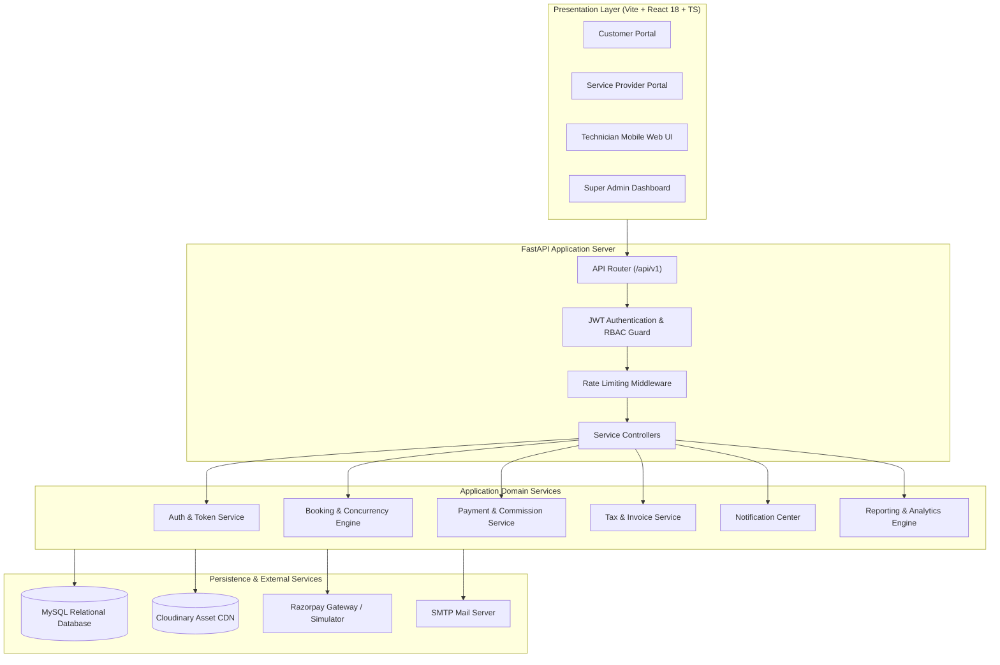
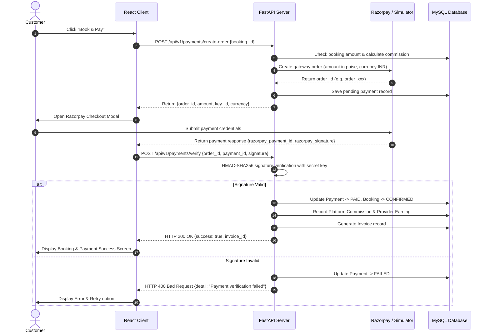

# HomeServe Technologies — System Architecture Document

## 1. High-Level Architectural Overview

HomeServe Technologies implements a decoupled, modern multi-tier client-server architecture:
- **Presentation Layer**: Single Page Application (SPA) built with React 18, TypeScript, Vite, Tailwind CSS, and TanStack Query.
- **API Gateway & Application Layer**: FastAPI (Python 3.11) asynchronous RESTful backend utilizing dependency injection, Pydantic schemas for data validation, and role-based middleware.
- **Persistence Layer**: Relational database running MySQL 8.0+ managed via SQLAlchemy ORM (2.0+) and Alembic for automated schema migrations. Seamless fallback to SQLite for local development and test automation.
- **Third-Party Services**: Razorpay payment gateway (Test Mode / sandbox simulation), Cloudinary CDN for secure image and document storage, and SMTP for transactional email dispatch.



---

## 2. Component Design & Directory Structure

```
homeserve-technologies/
├── frontend/                     # React 18 + TypeScript + Vite + Tailwind CSS
│   ├── public/                   # Static assets & favicon
│   ├── src/
│   │   ├── assets/               # Branding images, icons, illustrations
│   │   ├── components/           # Reusable UI library (Button, Modal, Card, Table, Badge, Form)
│   │   ├── layouts/              # AuthLayout, PublicLayout, DashboardLayout (Role-aware)
│   │   ├── pages/
│   │   │   ├── public/           # Landing, About, Services, FAQ, Contact, Login, Register
│   │   │   ├── customer/         # Dashboard, Bookings, Checkout, Addresses, Favorites, Reviews
│   │   │   ├── provider/         # Dashboard, Services, Schedule, Requests, Technicians, Earnings
│   │   │   ├── technician/       # Dashboard, AssignedJobs, JobDetails, CompletionReport
│   │   │   └── admin/            # Dashboard, Providers, Categories, Bookings, Payouts, Reports
│   │   ├── routes/               # ProtectedRoute, RoleGuard, AppRoutes
│   │   ├── services/             # Axios API client modules (authApi, bookingApi, serviceApi)
│   │   ├── hooks/                # Custom React hooks (useAuth, useNotifications, useDebounce)
│   │   ├── context/              # AuthContext, NotificationContext, ThemeContext
│   │   ├── schemas/              # Zod validation schemas
│   │   ├── utils/                # Date formatting, currency helpers, error parsers
│   │   ├── App.tsx               # Root component with QueryClientProvider & Router
│   │   └── main.tsx              # Application entry point
│   ├── package.json
│   ├── vite.config.ts
│   ├── tailwind.config.js
│   └── .env.example
│
├── backend/                      # FastAPI Application
│   ├── app/
│   │   ├── main.py               # FastAPI entry point, lifespan, CORS, middleware, routers
│   │   ├── core/
│   │   │   ├── config.py         # Pydantic BaseSettings, environment variables
│   │   │   ├── security.py       # Password hashing (bcrypt/argon2), JWT token encode/decode
│   │   │   ├── permissions.py    # Role checker dependencies (require_role, require_active)
│   │   │   └── database.py       # SQLAlchemy engine, session maker, get_db dependency
│   │   ├── models/               # SQLAlchemy 2.0 ORM Declarative Models
│   │   │   ├── user.py           # User, Customer, Provider, Technician, Address, Tokens
│   │   │   ├── catalog.py        # Category, Subcategory, Service, ProviderService, ServiceArea
│   │   │   ├── booking.py        # Booking, AvailabilitySlot, Assignment, History, Images
│   │   │   ├── finance.py        # Payment, Transaction, Invoice, Coupon, Earning, Payout
│   │   │   └── feedback.py       # Review, Response, Complaint, Notification, AuditLog
│   │   ├── schemas/              # Pydantic v2 schemas for request validation and response models
│   │   ├── api/
│   │   │   └── v1/
│   │   │       ├── auth.py       # Login, register, refresh, reset-password, me
│   │   │       ├── users.py      # Profile updates, password change
│   │   │       ├── customers.py   # Address CRUD, booking history, favorites
│   │   │       ├── providers.py  # KYC submission, working hours, services, statistics
│   │   │       ├── technicians.py# Job assignments, status updates, check-in
│   │   │       ├── categories.py # Categories & subcategories public & admin CRUD
│   │   │       ├── services.py   # Service catalog discovery & search
│   │   │       ├── bookings.py   # Booking creation, slot checking, lifecycle management
│   │   │       ├── payments.py   # Razorpay order generation, signature verification, receipts
│   │   │       ├── invoices.py   # Invoice rendering & download
│   │   │       ├── reviews.py    # Verified customer review submissions & moderation
│   │   │       ├── complaints.py # Dispute filing & resolution
│   │   │       ├── notifications.py # Notification retrieval and read-state management
│   │   │       ├── analytics.py  # Dashboard statistics for Admin, Provider, Customer
│   │   │       └── admin.py      # Provider verification, payouts, system configurations
│   │   ├── services/             # Pure business logic services (BookingService, PaymentService)
│   │   ├── utils/                # Email client, Cloudinary client, invoice generator
│   │   └── seed.py               # Database seeder for demo data, admin, categories & services
│   ├── alembic/                  # Alembic database migration scripts
│   ├── tests/                    # Pytest automated test suite
│   │   ├── conftest.py           # Test fixtures, DB session override, client fixture
│   │   ├── test_auth.py          # Auth & RBAC unit tests
│   │   ├── test_bookings.py      # Concurrency & double-booking prevention tests
│   │   └── test_payments.py      # Payment calculation and signature validation tests
│   ├── requirements.txt
│   └── .env.example
│
├── docs/                         # System Documentation
│   ├── requirements.md
│   ├── architecture.md
│   ├── database-design.md
│   ├── er-diagram.md
│   ├── api-documentation.md
│   ├── security-checklist.md
│   ├── testing-report.md
│   └── deployment-guide.md
├── postman/
│   └── HomeServe_API_Collection.json
├── README.md
├── DEVELOPMENT_LOG.md
└── .gitignore
```

---

## 3. Concurrency & Double-Booking Prevention Architecture

Double booking is an existential risk for home service platforms. The system uses a multi-layered concurrency prevention strategy:

1. **Pre-flight Availability Check**:
   - The customer selects a desired date, time slot, and service.
   - The backend validates the provider's active working hours for the selected day of the week, checks for existing active bookings (`CONFIRMED`, `PROVIDER_ASSIGNED`, `IN_PROGRESS`) during that window plus duration buffer.
2. **Atomic Booking Transaction**:
   - During the `POST /api/v1/bookings` call, the backend initiates an isolated database transaction.
   - For MySQL, it acquires a row-level lock on the provider's schedule record or locks matching potential conflict records using `SELECT ... FOR UPDATE` (or checks composite unique constraint `(provider_id, booking_date, time_slot)`).
   - If a concurrent transaction confirms the slot first, the second transaction catches a conflict exception and cleanly returns HTTP `409 Conflict` with a descriptive error message.
3. **Database Constraints**:
   - Each booking slot references `(provider_id, service_date, start_time, end_time)`.
   - Overlap check logic: `NOT (new_end <= existing_start OR new_start >= existing_end)`.

---

## 4. Payment Security & Integrity



---

## 5. UI/UX Design System Specification

- **Color Palette**:
  - `Primary / Navy`: `#0F172A` (Slate 900) & `#1E293B` (Slate 800)
  - `Brand Accent / Blue`: `#2563EB` (Blue 600) & `#1D4ED8` (Blue 700)
  - `Warm Accent / Orange`: `#F97316` (Orange 500) & `#EA580C` (Orange 600)
  - `Neutral Background`: `#F8FAFC` (Slate 50) and `#FFFFFF` (White)
  - `Status Colors`: Success `#10B981` (Emerald), Warning `#F59E0B` (Amber), Danger `#EF4444` (Red), Info `#3B82F6` (Blue)
- **Typography**: Inter / sans-serif with strict scale (12px, 14px, 16px, 18px, 24px, 32px, 40px).
- **Component Ergonomics**:
  - Rounded corners (`rounded-xl` / `rounded-2xl`).
  - Elevated cards with crisp micro-borders (`border border-slate-200/80 shadow-sm hover:shadow-md transition-shadow`).
  - Accessible form controls with explicit error labels, aria attributes, and auto-focus indicators.
  - Zero empty-state confusion: Every table and list has a thoughtful empty state with call-to-action buttons.
